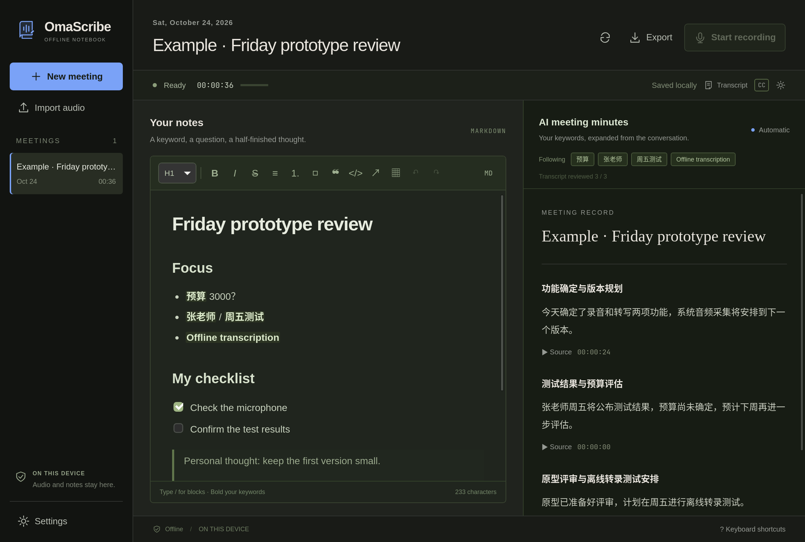
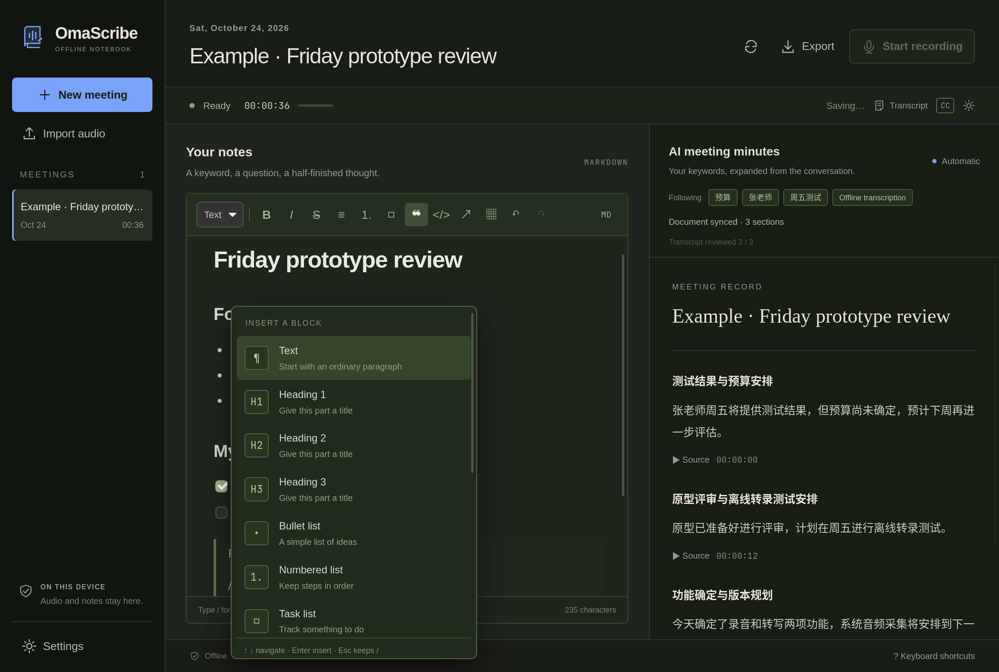
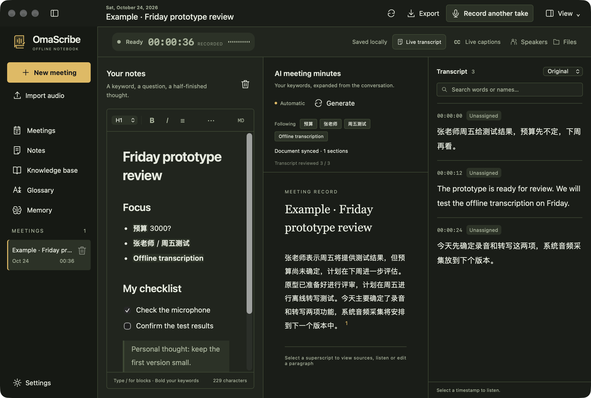
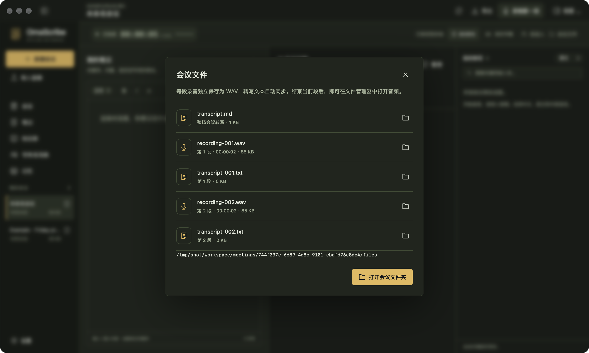

<p align="center">
  
</p>

<p align="center">
  <a href="README.md">English</a> · <a href="README.zh-CN.md">简体中文</a> · <a href="README.zh-TW.md">繁體中文</a>
</p>
<p align="center">
  <a href="https://github.com/EazyLee30/omascribe/actions/workflows/ci.yml"></a>
  <a href="LICENSE"></a>
  
  
  
</p>

# A few words from you. The context from your meeting.

**OmaScribe is an offline meeting recorder, bilingual transcriber, and Markdown notebook for Linux, macOS and Windows.** Write a keyword on the left; related meeting content appears in the AI minutes on the right, with the original source and an audio timestamp.

Built around a 2016 12-inch MacBook running Omarchy, with a dual-core Intel CPU and 8 GB RAM. The name combines **Oma**rchy and **Scribe**.

<p align="center"></p>
<p align="center"><sub>Actual Linux desktop window. The displayed meeting is a fictional test fixture.</sub></p>

<details>
<summary>See the editor tools and right-side transcript</summary>





</details>

## A notebook that listens

- **Start, pause, resume, finish.** Recording has its own file writer. Pauses do not create silence in the saved audio; resuming continues the current take. After **Finish take**, use **Record another take** in the same meeting—even after restarting the app. Earlier audio, corrections and sources stay intact. WAV, MP3, M4A, FLAC, Ogg and other FFmpeg-supported files can also be imported.
- **Find your files.** **Files** shows each take’s WAV and transcript, plus the complete meeting transcript. Open the folder or reveal an individual file in your file manager. Files update automatically; a WAV becomes available when its take finishes.
- **Write in Markdown, see a document.** A matching dark editor with headings, lists, tasks, tables, quotes, code, links, undo/redo, a toolbar, source mode, and Chinese input support.
- **Type `/` for tools.** Search blocks, insert a timestamp, highlight a keyword or start from a meeting template. Escape keeps the slash; a slash inside normal text or a path stays ordinary text.
- **Let the minutes develop automatically.** Your keywords guide bilingual lexical retrieval. A local model turns relevant transcript evidence into titled, readable paragraphs. No update button is required.
- **Choose your layout.** Collapse or expand the meeting list, your notes, AI minutes and transcript independently using each column’s panel icon. Collapsed columns keep a restore control; notes keep saving. The first three columns remember their layout; transcript visibility resets on restart for privacy. Narrow windows scroll horizontally instead of covering another column.
- **Place the transcript where you want it.** Right dock, movable/resizable floating window, compact mode, and left/right edge snap. Desktop captions can sit at the top or bottom of a chosen screen, with font, color, opacity, width, line count, alignment, margin and click-through controls.
- **Keep your authorship.** Your Markdown is never rewritten by AI. Editing a generated paragraph protects it from subsequent generation. Sources and audio timestamps stay attached; revised sources are flagged.
- **Export the whole meeting.** Your document, current AI minutes, original sources and transcript export to Markdown, optionally alongside WAV. English, 简体中文 and 繁體中文 interfaces are included.

### From a keyword to a paragraph

You write **预算 3000？** and **张老师 / 周五测试**. The conversation says:

> 张老师周五给测试结果，预算先不定，下周再看。

The intended result is a short written paragraph: “张老师将于周五提供测试结果。预算尚未确定，将于下周继续讨论。” Each paragraph links back to its evidence. The personal estimate `3000？` stays in your notebook.

The pipeline coalesces changes and runs one local writing task at a time. On this older laptop, minutes arrive in batches rather than word by word. Recording and transcription have priority. Generative prose can still be wrong: source, number and uncertainty checks reduce specific mistakes, but **do not prove factual correctness**.

## Download

[**Releases →**](https://github.com/EazyLee30/omascribe/releases) · [Build status](https://github.com/EazyLee30/omascribe/actions/workflows/native-release.yml)

| Computer | Package |
| --- | --- |
| Apple Silicon Mac | `macOS-AppleSilicon.dmg` |
| Intel Mac | `macOS-Intel.dmg` |
| Windows x64 | `Windows-x64.exe` |

Each native package includes ASR, the writing model and local inference runtimes (Metal + CPU on Apple Silicon). Windows also includes the offline WebView2 installer. WAV import works without extra software; compressed audio imports require FFmpeg on `PATH`. macOS packages are ad-hoc signed, not notarized; Windows packages have no publisher signature. See the [installation and test guide](docs/NATIVE_TESTING.md) for first launch, permissions and known limits. The release workflow publishes all five packages only after Linux CI and native package checks pass.

Linux x64 AVX2 packages are available as AppImage and `.deb` for Ubuntu 22.04+ and compatible distributions. Recording requires PipeWire. See the installation guide for dependencies.

## Build and install on Linux

**Current target:** x86-64 Linux with AVX2, PipeWire, GTK3, and WebKitGTK 4.1. Tested on Omarchy. This remains the hardware-tested baseline. macOS 11+ (Apple Silicon and Intel AVX2) and Windows 10/11 x64 AVX2 are native packages built on GitHub Actions.

Install the build dependencies on Arch / Omarchy:

```bash
sudo pacman -S --needed base-devel git cmake pkgconf nodejs npm python \
  gtk3 webkit2gtk-4.1 openssl librsvg ffmpeg pipewire wayland wayland-protocols xdotool
```

Install a current stable [Rust toolchain](https://www.rust-lang.org/tools/install), then:

```bash
git clone https://github.com/EazyLee30/omascribe.git
cd omascribe
bin/build          # One compile job by default, suitable for an 8 GB machine
bin/setup          # Download verified models and build pinned llama.cpp and native caption support
bin/install        # Install to your user account and app launcher
~/.local/bin/omascribe
```

Setup needs a network connection, roughly 1.6 GB of model downloads, and additional space for build caches. **After setup, recording, transcription, editing, inference, and export run offline.** No account or API key is required. Models are not stored in Git. Native installers include the verified models; Linux source installs download them during setup.

`OMASCRIBE_BUILD_JOBS=2 bin/build` allows a faster build on a machine with more headroom. Compiling on a fanless MacBook can make it warm and temporarily slow the desktop.

## Use it

1. Create a meeting and choose your microphone in **Settings**.
2. **Start recording.** Write naturally; use the toolbar, Markdown shortcuts or `/` menu. Bold a topic or a name to guide retrieval.
3. The AI document develops automatically on the right. Open **Transcript** for the right dock; use its arrow to open a floating view and **CC** for screen captions. The transcript selector switches the live display between original, bilingual, or one-way on-device translation; the minutes language (auto/Chinese/English) is chosen in **Settings**.
4. **Pause** when needed, then **Resume**. Click a source timestamp to listen, or edit a paragraph to preserve your wording.
5. **Finish take** stops this recording. Once its transcript is saved, **Record another take** adds a new recording to the same meeting. **Files** opens the recording and transcript folder. Leave the app open for remaining document batches, then export.

| Shortcut | Action |
| --- | --- |
| `Ctrl Shift R` | Start / finish recording; resume when paused |
| `Ctrl Shift P` | Pause / resume recording |
| `Ctrl B` / `Ctrl I` | Bold / italic |
| `Ctrl K` | Insert or edit a link |
| `Ctrl Alt 1` / `2` / `3` | Heading level |
| `Ctrl Shift 8` / `7` / `9` | Bullet / numbered / task list |
| `Ctrl Z` / `Ctrl Shift Z` | Undo / redo |
| `Ctrl F` | Open and search the right transcript dock |
| `Ctrl N` | New meeting |
| `/` at the start of a paragraph | Block menu; arrows + Enter to select, Escape for literal text |

On macOS, use **⌘** in place of **Ctrl**.

## Local by construction

```text
Microphone / audio file → independent PCM writer → streaming ASR → SQLite
                                                                  ↓
Markdown → keywords → lexical RAG → bounded writer → validation → document revisions
                                                                  ↓
                                                        automatic merge · playback · export
```

The note model runs only when needed, with one request. Defaults are one thread and a 2,048-token context; both are configurable. It unloads after each pass. Writing streams locally with phase/elapsed-time feedback; incomplete responses never replace the saved document. Low available memory postpones writing, and repeated failures back off automatically. A sustained ASR backlog cancels note inference. Audio never passes through the WebView.

Default storage on Linux: `~/.local/share/omascribe/` (or `$XDG_DATA_HOME/omascribe`). macOS uses `~/Library/Application Support/OmaScribe`; Windows uses `%LOCALAPPDATA%\io.omarchy.omascribe`. It contains recordings, the SQLite database, and exports. Linux source installs also keep models and runtime here; native installers keep those in application resources. Linux/macOS directories are user-only and Windows uses the account’s inherited ACL; files are **not encrypted** by the app.

| Environment variable | Override |
| --- | --- |
| `OMASCRIBE_DATA_DIR` | Meeting workspace |
| `OMASCRIBE_MODELS_DIR` | Model directory |
| `OMASCRIBE_RUNTIME_DIR` | ASR worker and `llama/` runtime directory |

A CLI is included: `omascribe-cli diagnose`, `import`, `record`, `replay`, `append`, `files`, `retranscribe`, `snapshot`, `note`, `generate`, `translate`, and `export`. Results are JSON. Run `omascribe-cli help` for arguments. Only one process may write to a workspace at a time.

## Validation and limits

See the [hardware test report](docs/BENCHMARKS.md) and [reproduction guide](docs/TESTING.md). Public audio and a clearly fictional note fixture are used; no private meeting recording is included. A short clip or repeated-sample stress test cannot establish real meeting CER/WER or caption P95 latency.

Current boundaries:

- Microphone capture and file import; no system-audio mixer yet. Optional local speaker separation runs after transcription (up to two hours).
- Mandarin/English ASR is a small, older model. Names, far-field speech, overlap, and code-switching need your own evaluation.
- Keywords guide **note retrieval**, not ASR hotword bias, in this release.
- Small-model writing can omit facts or misread a correction. Generated paragraphs need review; edited paragraphs are never automatically rewritten.
- On-device translation fills in after recording and writing go idle and never alters the originals; small models can still misread negation or numbers in a translation.
- On Linux, floating-window edge placement integrates with Hyprland and screen captions require Wayland layer-shell. macOS/Windows use native always-on-top caption windows; behavior across full-screen Spaces and multiple monitors needs physical-device testing.
- No embedding-based semantic search. Retrieval uses bounded lexical matching, with opt-in knowledge notes and user-maintained memory.
- Keep the machine awake during a meeting. Sleep/driver recovery and automatic sleep inhibition are not yet fully validated.
- There is no cloud sync or cross-meeting search. Signed app updates are off by default and require an explicit opt-in.

## Project notes

- [Architecture](docs/ARCHITECTURE.md) · [Models, hashes, and licenses](docs/MODELS.md)
- [Contributing](CONTRIBUTING.md) · [Privacy and security](SECURITY.md)
- Inspired by the user-guided note interaction in [Google Foresight](https://developers.google.com/edge/foresight); this is an independent Rust/Tauri implementation.
- Built with [Tauri](https://tauri.app/), [Tiptap](https://tiptap.dev/), [sherpa-onnx](https://github.com/k2-fsa/sherpa-onnx), [llama.cpp](https://github.com/ggml-org/llama.cpp), and [Qwen](https://huggingface.co/Qwen).

Code and original artwork: [MIT](LICENSE). Third-party models and dependencies retain their own licenses.

## Local workspace

Appearance, hardware-based model presets, verified model download/removal, portable JSON configurations, notes, opt-in knowledge, glossary, memory and editable speaker labels are available from the sidebar and Settings. See the [local workspace guide](docs/LOCAL_WORKSPACE.md) for behavior and limits.
