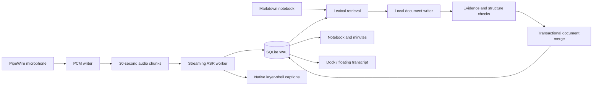

# Architecture

OmaScribe is a local Tauri 2 shell around a Rust recording engine. The WebView edits documents and displays state; it never carries raw audio. ASR and language inference live in separate processes.

## Recording state machine

`draft → recording ⇄ paused → transcribing → ready`.

The capture process is stopped and drained on pause. PCM stays contiguous, so timestamps measure recorded audio rather than wall time including pauses. Resume validates the persisted sample count and appends; it does not restart or overwrite the meeting. A pause marker lets ASR finalize a pending phrase without terminating the recognizer. Finish from either recording or paused state marks capture complete and drains remaining ASR input. Capture, pause and finish transitions are serialized.

The writer rotates every 30 seconds and flushes regularly. ASR reads the stored stream independently. An inference crash does not remove audio. The next startup recovers interrupted PCM, marks the meeting interrupted, and offers retranscription. Recovery is not a guarantee of seamless device/suspend recovery.

## Automatic document pipeline

The code is split into `notes/retrieval.rs`, `notes/writer.rs`, `notes/validation.rs`, the local process adapter in `notes.rs`, and the transactional repository in `store.rs`.

1. **Schedule.** A two-second coordinator detects committed transcript, keyword and source-revision changes. Manual editing gets a five-second debounce. Repeated work on one meeting waits at least 45 seconds after the previous task completes, with one generation in flight. A live meeting gets priority; unfinished enabled meetings are also drained. No UI update action is required.
2. **Retrieve.** A transient per-meeting lexical index combines BM25, English tokens, Chinese characters/bigrams and exact keyword hits, including two-character names. The oldest unprocessed prefix prevents silent coverage gaps. Related earlier evidence and stale paragraph sources add context within a fixed budget. There is no resident embedding model or cross-meeting database search.
3. **Budget.** The real llama.cpp tokenizer enforces a 1,400-token input budget within a 2,048-token context. Historical hits are removed before pending content. Removing pending content also rolls back the proposed coverage cursor.
4. **Compose.** Qwen3-1.7B Q4_K_M writes up to three titled prose sections. Keywords guide topics and are explicitly not evidence. The model only supplies text and evidence IDs. Rust assigns stable section IDs and chooses merge targets; the model cannot address arbitrary paragraphs. Writing language follows the selected transcript (Chinese when Chinese content is present, otherwise English).
5. **Validate.** Reject invalid IDs, missing evidence, unsupported numeric literals, malformed sections and some lost-uncertainty cases. Quotes are taken from stored transcript, never trusted from model output. These checks are guardrails, not a semantic proof: names, relationships and nuanced negations can still be wrong.
6. **Merge.** Check transcript run/revisions, user-note fingerprint and manual protection again. Save document history, paragraphs and coverage in one SQLite transaction. Related unlocked paragraphs are recomposed only when their entire evidence is present in the selected context. Unrelated and human-edited paragraphs remain intact. The preceding document is archived so model omissions remain auditable. Cancelled, failed or superseded jobs never advance coverage.
7. **Observe.** `inference_jobs` records selected evidence revisions, model, pipeline version, outcome and elapsed time locally. `document_history` retains previous paragraph sets. `last-generation.json` retains the latest draft locally for diagnosis. These are developer recovery/audit data; there is no history browser yet.

The UI renders a single document with section headings, paragraphs and collapsed source references. Editing a paragraph marks it protected. Correcting source text preserves its original revision and flags affected paragraphs. Unlocked stale paragraphs are eligible for automatic reprocessing; protected paragraphs remain for human review.

## Resource policy

Audio capture and ASR outrank writing. ASR and LLM begin at one CPU thread each; the local model server handles one request and unloads after each task. A sustained ASR backlog terminates writing and preserves pending work. The authenticated HTTP endpoint binds only to `127.0.0.1`, uses a per-process random key, and ignores proxy environment variables.

The UI polls snapshots; active editor DOM and selection are not replaced. Markdown saves are debounced and serialized per document, with IME composition guards. The auxiliary transcript WebView uses a separate frontend entry so it does not load the editor bundle.

## Window surfaces

The main WebView owns the Markdown editor, minutes and optional right dock. An auxiliary undecorated Tauri window implements movable/resizable/compact transcript display. Transient Hyprland commands target only the current process's exact transcript window; no user compositor configuration is edited. Native GTK3 layer-shell renders screen captions with configurable screen, anchors and input region. Caption visibility resets off at startup; visual preferences persist locally.

## Boundaries

A source citation proves where a paragraph points, not whether the paragraph faithfully paraphrases it. ASR errors can propagate. A long recording may require multiple writing batches; the coverage display measures processed input, not completeness of every fact. The current model, retrieval policy and written style are replaceable adapters, with a reproducible regression harness rather than claims based on a generic benchmark.
