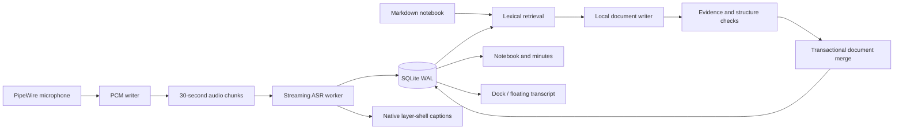

# Architecture

OmaScribe is a local Tauri 2 shell around a Rust recording engine. The WebView edits documents and displays state; it never carries raw audio. ASR and language inference live in separate processes.

## Recording state machine

`draft → recording ⇄ paused → transcribing → ready → recording …`.

A meeting owns numbered recording takes. Finish closes a take, not the meeting. Starting again appends at the persisted sample count and starts a fresh ASR recognizer at that offset and the next segment sequence number. The transcript run, human revisions, notes cursor and citation IDs are retained. The same path works after reopening the workspace. A full retranscription flushes and resets recognition at persisted take boundaries, keeping each take’s text aligned with its own WAV. Legacy recordings are migrated additively to take 1; interrupted takes keep every stored sample.

The capture process is stopped and drained on pause. PCM stays contiguous, so timestamps measure recorded audio rather than wall time including pauses. Resume validates the persisted sample count and appends; it does not restart or overwrite the meeting. A pause marker lets ASR finalize a pending phrase without terminating the recognizer. Finish from either recording or paused state marks capture complete and drains remaining ASR input. Capture, pause and finish transitions are serialized.

The writer rotates every 30 seconds and flushes regularly. ASR reads the stored stream independently. An inference crash does not remove audio. The next startup recovers interrupted PCM, marks the meeting interrupted, and offers retranscription. Recovery is not a guarantee of seamless device/suspend recovery.

## Readable meeting files

`meetings/<id>/files/` contains `recording-001.wav`, `transcript-001.txt`, subsequent numbered takes, and a complete `transcript.md`. WAV export streams a sample-exact range of the contiguous PCM timeline with bounded memory. Text mirrors update after finalized ASR segments and in-app corrections; per-take text uses take-relative timestamps, while the complete transcript and citations use the continuous meeting timeline. These are generated mirrors: edit transcript text in the app so revisions and citations remain consistent. PCM and SQLite remain authoritative.

File writes are serialized and replaced atomically; no UI operation deletes original media. The Files dialog refreshes while open and offers FileManager1 reveal with a folder-open fallback. Unfinished takes remain in PCM and cannot be opened as WAV until finalized.

## Automatic document pipeline

The code is split into `notes/retrieval.rs`, `notes/writer.rs`, `notes/validation.rs`, the local process adapter in `notes.rs`, and the transactional repository in `store.rs`.

1. **Schedule.** A two-second coordinator detects committed transcript, keyword and source-revision changes. Manual editing gets a five-second debounce. Repeated work on one meeting waits at least 45 seconds after the previous task completes, with one generation in flight. Consecutive failures increase the cooldown to 90/180/360 seconds, reset by success. A live meeting gets priority; unfinished enabled meetings are also drained. No UI update action is required.
2. **Retrieve.** A transient per-meeting lexical index combines BM25, English tokens, Chinese characters/bigrams and exact keyword hits, including two-character names. The oldest unprocessed prefix prevents silent coverage gaps. Related earlier evidence and stale paragraph sources add context within a fixed budget. There is no resident embedding model or cross-meeting database search.
3. **Budget.** The real llama.cpp tokenizer enforces a 900-token input budget within a 2,048-token context. Historical hits are removed before pending content. Removing pending content also rolls back the proposed coverage cursor.
4. **Compose.** Qwen3-1.7B Q4_K_M writes up to three short titled prose sections (440 output tokens maximum). Keywords guide topics and are explicitly not evidence. The model only supplies text and evidence IDs. Rust assigns stable section IDs and chooses merge targets; the model cannot address arbitrary paragraphs. Writing language follows the selected transcript (Chinese when Chinese content is present, otherwise English).
5. **Validate.** Reject invalid IDs, missing evidence, unsupported numeric literals, malformed sections and some lost-uncertainty cases. Quotes are taken from stored transcript, never trusted from model output. These checks are guardrails, not a semantic proof: names, relationships and nuanced negations can still be wrong.
6. **Merge.** Check transcript run/revisions, user-note fingerprint and manual protection again. Save document history, paragraphs and coverage in one SQLite transaction. Related unlocked paragraphs are recomposed only when their entire evidence is present in the selected context. Unrelated and human-edited paragraphs remain intact. The preceding document is archived so model omissions remain auditable. Cancelled, failed or superseded jobs never advance coverage.
7. **Observe.** `inference_jobs` records selected evidence revisions, model, pipeline version, outcome and elapsed time locally. `document_history` retains previous paragraph sets. `last-generation.json` retains the latest draft locally for diagnosis. These are developer recovery/audit data; there is no history browser yet.

The UI renders a single document with section headings, paragraphs and collapsed source references. Editing a paragraph marks it protected. Correcting source text preserves its original revision and flags affected paragraphs. Unlocked stale paragraphs are eligible for automatic reprocessing; protected paragraphs remain for human review.

## Resource policy

Audio capture and ASR outrank writing. Loading is deferred below a model-specific memory estimate (1,400 MiB for default 1.7B at 2,048 context). ASR and LLM default to one configurable CPU thread each; the local model server handles one request and unloads after each task. A sustained ASR backlog terminates writing and preserves pending work. SSE replaces the previous non-streaming 180-second request. Connection/write limits are 3/15 seconds, reads have a 300-second idle limit, startup is capped at 120 seconds, and a watchdog terminates a whole job after 600 seconds. Phase, elapsed time and received-character counts are visible without rendering unvalidated partial prose. A successful finish reason and terminal SSE event are required before validation/commit. Socket failures leave prior document and coverage intact. A validation failure can trigger one bounded repair using the original evidence and the specific failed check. The repair shares the same 600-second watchdog and must fit the context budget; the cursor advances only after the repaired document passes every check. Calendar validation accepts equivalent Chinese/Arabic date spellings and the weekday deterministically implied by an explicit complete date, but rejects unsupported dates, weekdays and amounts.

The authenticated HTTP endpoint binds only to `127.0.0.1`, uses a per-process random key, and ignores proxy environment variables.

The UI polls snapshots; active editor DOM and selection are not replaced. Markdown saves are debounced and serialized per document, with IME composition guards. The auxiliary transcript WebView uses a separate frontend entry so it does not load the editor bundle.

## Window surfaces

The main WebView owns the Markdown editor, minutes and optional right dock. An auxiliary undecorated Tauri window implements movable/resizable/compact transcript display. Transient Hyprland commands target only the current process's exact transcript window; no user compositor configuration is edited. Native GTK3 layer-shell renders screen captions with configurable screen, anchors and input region. Caption visibility resets off at startup; visual preferences persist locally.

## Boundaries

A source citation proves where a paragraph points, not whether the paragraph faithfully paraphrases it. ASR errors can propagate. A long recording may require multiple writing batches; the coverage display measures processed input, not completeness of every fact. The current model, retrieval policy and written style are replaceable adapters, with a reproducible regression harness rather than claims based on a generic benchmark.

## Desktop platform boundary

Linux retains PipeWire capture and GTK layer-shell captions. macOS/Windows use CPAL (CoreAudio/WASAPI); the audio callback sends mono float blocks through a bounded queue. A separate reader resamples to 16 kHz PCM with delay compensation and exact end flushing. Queue overflow or a device error ends the take visibly and preserves completed audio. Pause drains the current capture before resume opens a new stream. WAV import uses the same streaming resampler and requires no external decoder.

Data roots, file locks, subprocess termination, available-memory checks, and executable suffixes live behind a small platform boundary. Native packages resolve read-only models and binaries from their own resources; account data stays separate. macOS/Windows captions use an always-on-top transparent Tauri window; Linux keeps the compositor-native overlay.

The native release workflow gates on Linux CI for the exact commit, builds on three native hosted runners, verifies installed inference paths and public/fictional fixtures, then publishes all packages together. See [native testing](NATIVE_TESTING.md) for the distinction between hosted-runner checks and physical-device acceptance.

## Local workspace

`preferences.json` holds validated appearance/model/default settings. `library_entries` (schema version 4) stores standalone notes, glossary and manual memory, plus knowledge metadata for meeting notes. Context changes invalidate pending minutes; an in-memory context revision prevents stale in-flight commits. Downloads are staged under `model-store`, verified with SHA-256, then renamed atomically. A shared configuration gate serializes model changes against job start. Speaker analysis runs in the ASR sidecar after capture and ASR, commits assignments/history transactionally, and preserves manually confirmed assignments. Details: [local workspace](LOCAL_WORKSPACE.md).
