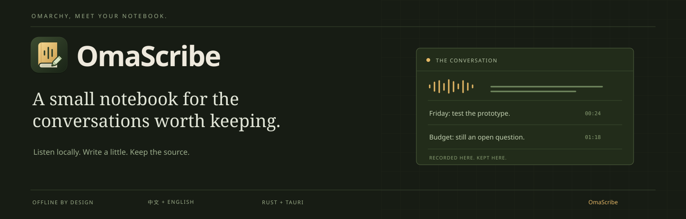
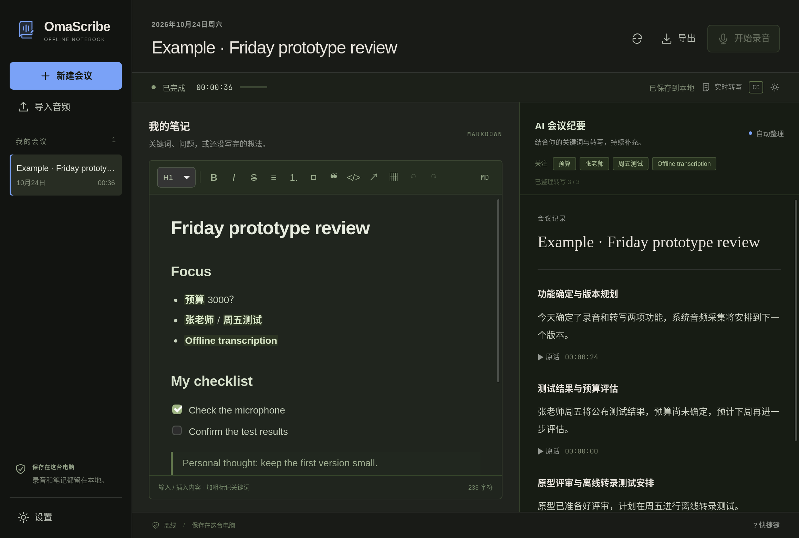

<p align="center"></p>
<p align="center"><a href="../../README.md">English</a> · <b>简体中文</b> · <a href="README.zh-TW.md">繁體中文</a></p>
<p align="center">
<a href="https://github.com/EazyLee30/omascribe/actions/workflows/ci.yml"></a>
<a href="../../LICENSE"></a>


</p>

# 你写几个词，会议补全上下文。

**OmaScribe 是面向桌面的离线录音、中英转写与 Markdown 会议笔记应用。** 左侧随手记录关键词，右侧结合会议原话，自动整理为有标题、有段落、可回听的会议文档。

围绕一台运行 Omarchy 的 2016 年 12 英寸 MacBook 开发：双核 Intel、8GB 内存。名字来自 **Oma**rchy 与 **Scribe**。

<p align="center"><br><sub>实际应用渲染；图中会议内容为虚构测试样本。</sub></p>

## 一边听，一边写

- **会议文件。** 可查看每段 WAV、分段转写与完整转写，并在文件管理器中定位。文本自动同步，结束本段后生成可播放的 WAV。
- **开始、暂停、继续、结束。** 录音独立写盘，暂停时停止采音，继续时接着当前这一段录音。「结束本段」后可以「录制新一段」，同一会议能保留多段录音，重启后也能继续追加。也支持导入 WAV、MP3、M4A、FLAC、Ogg 等音频。
- **Markdown 输入，文档呈现。** 与工作区融为一体的编辑器，支持标题、列表、待办、表格、引用、代码、链接、撤销重做、源码切换和中文输入法。输入 `/` 插入内容，选中文字时显示格式工具。
- **用 `/` 快速操作。** 搜索内容块、插入录音时间戳、标记关键词、使用会议模板。按 Escape 保留普通斜杠；正文和路径中的斜杠不会弹出菜单。
- **自动形成会议纪要。** 关键词引导中英检索，本地模型将相关转写整理为流畅段落，无需手动点击更新。
- **按需收起各栏。** 会议支持标签页；面板可拖动分栏、合并标签、浮动、最大化或隐藏，支持保存命名布局与恢复默认布局。窄窗口采用面板标签，外层工作区固定。
- **转写位置由你决定。** 右侧停靠、可拖动和缩放的浮窗、收起模式、左右吸附。屏幕字幕支持顶部／底部、显示器、字号、颜色、透明度、宽度、行数、边距、对齐和鼠标穿透设置。
- **人工内容始终由你掌控。** AI 不改写左侧笔记；人工编辑右侧段落后，该段受到保护。每段保留原话和录音时间戳，转写被修改时会提示复核。
- **完整导出。** 导出个人文档、当前纪要、出处与转写，可同时导出 WAV。界面提供英语、简体中文与繁体中文。

## 关键词如何变成文档

你写下 `预算 3000？` 和 `张老师 / 周五测试`，原话是：

> 张老师周五给测试结果，预算先不定，下周再看。

期望的纪要是：“张老师将于周五提供测试结果。预算尚未确定，将于下周继续讨论。” 每段能展开对应原话，`3000？` 仍是你的个人笔记。

系统合并频繁变化，单次只运行一个写作任务。在这台老电脑上，纪要按批次出现，录音和转写优先。**小模型仍可能理解错误或遗漏内容**；出处、数字和未定状态校验只能减少部分错误，不能证明所有内容都正确。

## 下载安装包

[**GitHub Releases →**](https://github.com/EazyLee30/omascribe/releases) · [构建状态](https://github.com/EazyLee30/omascribe/actions/workflows/native-release.yml)

Apple Silicon 选 `macOS-AppleSilicon.dmg`，Intel Mac 选 `macOS-Intel.dmg`，Windows 选 `Windows-x64.exe`。安装包包含离线模型和推理运行时；Windows 另包含离线 WebView2 安装器。WAV 可直接导入，其他压缩格式需要 PATH 中有 FFmpeg。macOS 使用临时签名、未公证；Windows 尚无发行者签名。查看[安装与测试指南](../NATIVE_TESTING.md)。五种安装包全部通过流水线检查后才发布。

macOS 快捷键使用 **⌘** 替代 **Ctrl**。数据位于 `~/Library/Application Support/OmaScribe`；Windows 位于 `%LOCALAPPDATA%\io.omarchy.omascribe`。

Linux x64 AVX2 提供 AppImage 和 `.deb`，适用于 Ubuntu 22.04+ 及兼容发行版。麦克风录音需要运行 PipeWire，依赖与安装方式见上述指南。

## 构建与安装

当前支持 **x86-64 / AVX2 Linux、PipeWire、GTK3、WebKitGTK 4.1**，在 Omarchy 上验证。macOS 11+（Apple Silicon／Intel AVX2）和 Windows 10/11 x64 AVX2 提供由 GitHub Actions 构建的原生安装包。

```bash
sudo pacman -S --needed base-devel git cmake pkgconf nodejs npm python \
  gtk3 webkit2gtk-4.1 openssl librsvg ffmpeg pipewire wayland wayland-protocols xdotool
```

准备稳定版 [Rust 工具链](https://www.rust-lang.org/tools/install)，然后：

```bash
git clone https://github.com/EazyLee30/omascribe.git
cd omascribe
scripts/bin/build       # 默认单任务编译
scripts/bin/setup       # 下载校验过的模型，构建本地推理与字幕运行库
scripts/bin/install     # 安装到当前用户及应用启动器
~/.local/bin/omascribe
```

首次准备需要联网，模型下载约 1.6GB，另需编译缓存空间。准备好后，录音、转写、编辑、推理与导出均可离线使用，无需账户或 API Key。模型不进入 Git 仓库。无风扇设备编译时可能升温并暂时影响桌面响应。

## 日常使用

1. 新建会议，在设置中选择麦克风。
2. 开始录音。用选中文字后的格式工具、Markdown 语法或 `/` 菜单记录，把重点词加粗。
3. 右侧纪要自动更新。点击「实时转写」打开右侧栏，齿轮调整显示方式，**CC** 控制屏幕字幕。转写栏的下拉可在原文、双语、中译英、英译中之间切换实时显示，全部由本地模型完成；纪要语言（自动／中文／英文）在设置中选择。
4. 按需暂停、继续。点击出处回听，编辑纪要段落可保留自己的措辞。
5. 「结束本段」只停止当前录音。转写保存后，可在同一会议「录制新一段」；「会议文件」可打开录音与转写文件夹。剩余纪要会自动完成。

| 快捷键 | 操作 |
| --- | --- |
| `Ctrl Shift R` | 开始／结束录音；暂停时继续 |
| `Ctrl Shift P` | 暂停／继续 |
| `Ctrl B` / `Ctrl I` | 加粗／斜体 |
| `Ctrl K` | 插入或修改链接 |
| `Ctrl Alt 1 / 2 / 3` | 标题层级 |
| `Ctrl Shift 8 / 7 / 9` | 无序／有序／待办列表 |
| `Ctrl Z` / `Ctrl Shift Z` | 撤销／重做 |
| `Ctrl F` | 打开右侧转写并搜索 |
| `Ctrl N` | 新建会议 |
| 空段落开头输入 `/` | 内容菜单；方向键选择、Enter 确定、Escape 保留斜杠 |

## 本地架构与边界

`独立录音 → 流式 ASR → SQLite → 关键词与词法 RAG → 小模型写作 → 校验 → 文档版本保存`

默认使用双语 Zipformer 和 Qwen3-1.7B Q4_K_M。写作默认单线程、单请求、2,048 token 上下文（线程和上下文可设置），每轮任务后释放模型。写作采用本地流式接收，显示处理阶段与耗时；内存不足时延后整理，连续失败会降低重试频率。转写持续积压时，自动让出写作算力。失败和取消不会推进已处理位置。

Linux 默认数据位于 `~/.local/share/omascribe/`，遵循 `$XDG_DATA_HOME`；macOS 和 Windows 路径见上方安装说明。Linux/macOS 目录仅当前用户可访问，Windows 使用用户账户继承的访问权限；应用本身不加密文件。可用 `OMASCRIBE_DATA_DIR`、`OMASCRIBE_MODELS_DIR`、`OMASCRIBE_RUNTIME_DIR` 指定位置。CLI 提供 `diagnose`、`import`、`record`、`replay`、`append`、`files`、`retranscribe`、`snapshot`、`note`、`generate`、`translate`、`export`，输出 JSON。

- 当前采集麦克风，尚未实现系统音频混录。可选本地说话人分离在转写结束后运行，单次最长两小时。
- 小型 ASR 的人名、远场、重叠说话和中英混说准确率仍需真实场景评估。笔记名称和启用的专有名词可辅助本机识别、笔记检索与有依据的拼写校正；保留原始识别记录和人工修改，不把含混片段强行替换成笔记里的词。
- RAG 使用会议内 BM25、中文字符／双字及精确词匹配，不常驻向量模型。
- 本地翻译在录音和写作空闲后补上译文，从不改动原文；小模型译文仍需核对数字与否定语气。
- Linux 浮窗吸附集成 Hyprland，屏幕字幕使用 Wayland layer-shell；macOS/Windows 使用原生置顶字幕窗口，全屏空间与多显示器行为仍需真机测试。
- 会议期间请保持电脑唤醒；睡眠、驱动切换后的恢复尚未充分验证。
- 没有云同步或跨会议搜索；签名更新默认关闭，需手动开启。

[实测报告](../BENCHMARKS.md) · [测试与回归 harness](../TESTING.md) · [架构](../ARCHITECTURE.md) · [模型与许可证](../MODELS.md) · [贡献](../../.github/CONTRIBUTING.md) · [隐私](../../.github/SECURITY.md)

交互灵感来自 [Google Foresight](https://developers.google.com/edge/foresight)，这是独立的 Rust/Tauri 实现。感谢 Tauri、Tiptap、sherpa-onnx、llama.cpp、Qwen 和 gtk-layer-shell。代码及原创图形采用 [MIT](../../LICENSE)；第三方模型与依赖保留各自许可证。

## 本地工作区

侧栏已包含会议、笔记、知识库、专有名词表与记忆。设置提供系统/浅色/深色外观、主题与字体、硬件检测和模型搭配、下载与删除模型、JSON 配置导出/导入，以及存储统计。可选择区分说话人、改名和修正片段归属，纪要与导出会使用姓名。知识库和记忆默认关闭，配置分享不包含个人内容。详见[本地工作区说明](../LOCAL_WORKSPACE.md)。
