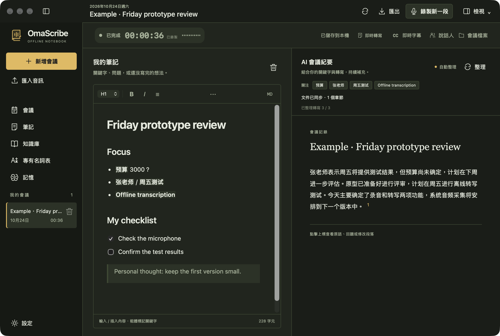

<p align="center"></p>
<p align="center"><a href="../../README.md">English</a> · <a href="README.zh-CN.md">简体中文</a> · <b>繁體中文</b></p>
<p align="center">
<a href="https://github.com/EazyLee30/omascribe/actions/workflows/ci.yml"></a>
<a href="../../LICENSE"></a>


</p>

# 你寫幾個詞，會議補全上下文。

**OmaScribe 是面向桌面的離線錄音、中英轉寫與 Markdown 會議筆記應用。** 左側隨手記錄關鍵詞，右側結合會議原話，自動整理為有標題、有段落、可回聽的會議文件。

圍繞一臺執行 Omarchy 的 2016 年 12 英寸 MacBook 開發：雙核 Intel、8GB 記憶體。名字來自 **Oma**rchy 與 **Scribe**。

<p align="center"><br><sub>實際應用渲染；圖中會議內容為虛構測試樣本。</sub></p>

## 一邊聽，一邊寫

- **會議檔案。** 可查看每段 WAV、分段轉寫與完整轉寫，並在檔案管理員中定位。文字自動同步，結束本段後產生可播放的 WAV。
- **開始、暫停、繼續、結束。** 錄音獨立寫盤，暫停時停止採音，繼續時接著目前這一段錄音。「結束本段」後可以「錄製新一段」，同一會議能保留多段錄音，重啟後也能繼續追加。也支援匯入 WAV、MP3、M4A、FLAC、Ogg 等音訊。
- **Markdown 輸入，文件呈現。** 與應用統一的深色編輯器，支援工具欄、標題、列表、待辦、表格、引用、程式碼、連結、撤銷重做、原始碼切換和中文輸入法。
- **用 `/` 快速操作。** 搜尋內容塊、插入錄音時間戳、標記關鍵詞、使用會議模板。按 Escape 保留普通斜槓；正文和路徑中的斜槓不會彈出選單。
- **自動形成會議紀要。** 關鍵詞引導中英檢索，本地模型將相關轉寫整理為流暢段落，無需手動點選更新。
- **按需收起各欄。** 會議支援分頁；面板可拖曳分欄、合併分頁、浮動、最大化或隱藏，支援儲存命名版面與還原預設版面。窄視窗採用面板分頁，外層工作區固定。
- **轉寫位置由你決定。** 右側停靠、可拖動和縮放的浮窗、收起模式、左右吸附。螢幕字幕支援頂部／底部、顯示器、字號、顏色、透明度、寬度、行數、邊距、對齊和滑鼠穿透設定。
- **人工內容始終由你掌控。** AI 不改寫左側筆記；人工編輯右側段落後，該段受到保護。每段保留原話和錄音時間戳，轉寫被修改時會提示覆核。
- **完整匯出。** 匯出個人文件、當前紀要、出處與轉寫，可同時匯出 WAV。介面提供英語、簡體中文與繁體中文。

## 關鍵詞如何變成文件

你寫下 `預算 3000？` 和 `張老師 / 週五測試`，原話是：

> 張老師週五給測試結果，預算先不定，下週再看。

期望的紀要是：“張老師將於週五提供測試結果。預算尚未確定，將於下週繼續討論。” 每段能展開對應原話，`3000？` 仍是你的個人筆記。

系統合併頻繁變化，單次只執行一個寫作任務。在這臺老電腦上，紀要按批次出現，錄音和轉寫優先。**小模型仍可能理解錯誤或遺漏內容**；出處、數字和未定狀態校驗只能減少部分錯誤，不能證明所有內容都正確。

## 下載安裝包

[**GitHub Releases →**](https://github.com/EazyLee30/omascribe/releases) · [建置狀態](https://github.com/EazyLee30/omascribe/actions/workflows/native-release.yml)

Apple Silicon 選 `macOS-AppleSilicon.dmg`，Intel Mac 選 `macOS-Intel.dmg`，Windows 選 `Windows-x64.exe`。安裝包包含離線模型及推理執行環境；Windows 另包含離線 WebView2 安裝器。WAV 可直接匯入，其他壓縮格式需要 PATH 中有 FFmpeg。macOS 使用臨時簽章、未公證；Windows 尚無發行者簽章。請查看[安裝與測試指南](../NATIVE_TESTING.md)。五種安裝包全部通過流程檢查後才發佈。

macOS 快捷鍵以 **⌘** 取代 **Ctrl**。資料位於 `~/Library/Application Support/OmaScribe`；Windows 位於 `%LOCALAPPDATA%\io.omarchy.omascribe`。

Linux x64 AVX2 提供 AppImage 與 `.deb`，適用於 Ubuntu 22.04+ 及相容發行版。麥克風錄音需執行 PipeWire，相依套件與安裝方式見上述指南。

## 構建與安裝

當前支援 **x86-64 / AVX2 Linux、PipeWire、GTK3、WebKitGTK 4.1**，在 Omarchy 上驗證。macOS 11+（Apple Silicon／Intel AVX2）及 Windows 10/11 x64 AVX2 提供由 GitHub Actions 建置的原生安裝包。

```bash
sudo pacman -S --needed base-devel git cmake pkgconf nodejs npm python \
  gtk3 webkit2gtk-4.1 openssl librsvg ffmpeg pipewire wayland wayland-protocols xdotool
```

準備穩定版 [Rust 工具鏈](https://www.rust-lang.org/tools/install)，然後：

```bash
git clone https://github.com/EazyLee30/omascribe.git
cd omascribe
scripts/bin/build       # 預設單任務編譯
scripts/bin/setup       # 下載校驗過的模型，構建本地推理與字幕執行庫
scripts/bin/install     # 安裝到當前使用者及應用啟動器
~/.local/bin/omascribe
```

首次準備需要聯網，模型下載約 1.6GB，另需編譯快取空間。準備好後，錄音、轉寫、編輯、推理與匯出均可離線使用，無需賬戶或 API Key。模型不進入 Git 倉庫。無風扇裝置編譯時可能升溫並暫時影響桌面響應。

## 日常使用

1. 新建會議，在設定中選擇麥克風。
2. 開始錄音。用工具欄、Markdown 語法或 `/` 選單記錄，把重點詞加粗。
3. 右側紀要自動更新。點選「即時轉寫」開啟右側欄，齒輪調整顯示方式，**CC** 控制螢幕字幕。轉寫欄的下拉可在原文、雙語、中譯英、英譯中之間切換即時顯示，全部由本機模型完成；紀要語言（自動／中文／英文）在設定中選擇。
4. 按需暫停、繼續。點擊出處回聽，編輯紀要段落可保留自己的措辭。
5. 「結束本段」只停止目前錄音。轉寫儲存後，可在同一會議「錄製新一段」；「會議檔案」可開啟錄音與轉寫資料夾。剩餘紀要會自動完成。

| 快捷鍵 | 操作 |
| --- | --- |
| `Ctrl Shift R` | 開始／結束錄音；暫停時繼續 |
| `Ctrl Shift P` | 暫停／繼續 |
| `Ctrl B` / `Ctrl I` | 加粗／斜體 |
| `Ctrl K` | 插入或修改連結 |
| `Ctrl Alt 1 / 2 / 3` | 標題層級 |
| `Ctrl Shift 8 / 7 / 9` | 無序／有序／待辦列表 |
| `Ctrl Z` / `Ctrl Shift Z` | 撤銷／重做 |
| `Ctrl F` | 開啟右側轉寫並搜尋 |
| `Ctrl N` | 新建會議 |
| 空段落開頭輸入 `/` | 內容選單；方向鍵選擇、Enter 確定、Escape 保留斜槓 |

## 本地架構與邊界

`獨立錄音 → 流式 ASR → SQLite → 關鍵詞與詞法 RAG → 小模型寫作 → 校驗 → 文件版本儲存`

預設使用雙語 Zipformer 和 Qwen3-1.7B Q4_K_M。寫作預設單執行緒、單請求、2,048 token 上下文（執行緒及上下文可設定），每輪任務後釋放模型。寫作採用本機串流接收，顯示處理階段與耗時；記憶體不足時延後整理，連續失敗會降低重試頻率。轉寫持續積壓時，自動讓出寫作算力。失敗和取消不會推進已處理位置。

Linux 預設資料位於 `~/.local/share/omascribe/`，遵循 `$XDG_DATA_HOME`；macOS 和 Windows 路徑見上方安裝說明。Linux/macOS 目錄僅當前使用者可存取，Windows 使用使用者帳戶繼承的存取權限；應用本身不加密檔案。可用 `OMASCRIBE_DATA_DIR`、`OMASCRIBE_MODELS_DIR`、`OMASCRIBE_RUNTIME_DIR` 指定位置。CLI 提供 `diagnose`、`import`、`record`、`replay`、`append`、`files`、`retranscribe`、`snapshot`、`note`、`generate`、`translate`、`export`，輸出 JSON。

- 當前採集麥克風，尚未實現系統音訊混錄。可選本機說話人分離在轉寫結束後執行，單次最長兩小時。
- 小型 ASR 的人名、遠場、重疊說話和中英混說準確率需要真實場景評估；關鍵詞當前用於筆記檢索，不做 ASR 熱詞偏置。
- RAG 使用會議內 BM25、中文字元／雙字及精確詞匹配，不常駐向量模型。
- 本機翻譯在錄音和寫作閒置後補上譯文，從不改動原文；小模型譯文仍需核對數字與否定語氣。
- Linux 浮窗吸附整合 Hyprland，螢幕字幕使用 Wayland layer-shell；macOS/Windows 使用原生置頂字幕視窗，全螢幕空間與多顯示器行為仍需實機測試。
- 會議期間請保持電腦喚醒；睡眠、驅動切換後的恢復尚未充分驗證。
- 沒有云同步或跨會議搜尋；簽名更新預設關閉，需手動開啟。

[實測報告](../BENCHMARKS.md) · [測試與迴歸 harness](../TESTING.md) · [架構](../ARCHITECTURE.md) · [模型與許可證](../MODELS.md) · [貢獻](../../.github/CONTRIBUTING.md) · [隱私](../../.github/SECURITY.md)

互動靈感來自 [Google Foresight](https://developers.google.com/edge/foresight)，這是獨立的 Rust/Tauri 實現。感謝 Tauri、Tiptap、sherpa-onnx、llama.cpp、Qwen 和 gtk-layer-shell。程式碼及原創圖形採用 [MIT](../../LICENSE)；第三方模型與依賴保留各自許可證。

## 本機工作區

側欄包含會議、筆記、知識庫、專有名詞表與記憶。設定提供系統/淺色/深色外觀、主題與字體、硬體偵測與模型搭配、模型下載及刪除、JSON 設定匯出/匯入，以及儲存統計。可選擇區分說話人、改名與修正片段歸屬，紀要及匯出會使用姓名。知識庫與記憶預設關閉，設定分享不含個人內容。詳見[本機工作區說明](../LOCAL_WORKSPACE.md)。
